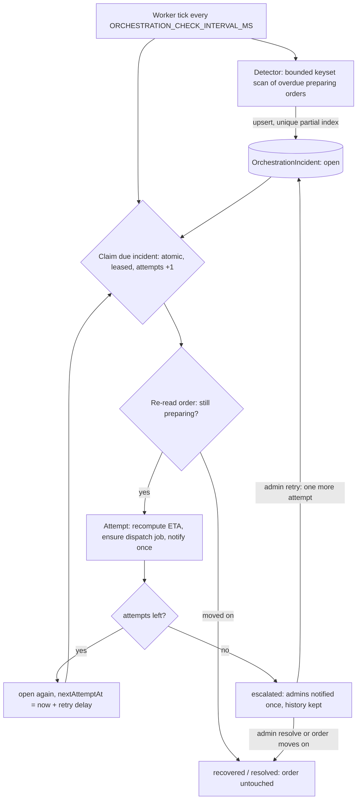

# Foodify

Full-stack food ordering and delivery platform with three roles — **customers**, **restaurant owners** and **delivery partners** — in a pnpm workspace.

| Area | Stack |
|------|-------|
| Frontend (`frontend/`) | React 19, Vite, Tailwind CSS v4, Redux Toolkit, Leaflet, Recharts, Firebase Auth (Google) |
| Backend (`backend/`) | Node 24, Express 5, TypeScript (strict), Mongoose/MongoDB, Socket.io, optional Redis |
| Shared (`packages/validation`) | Zod schemas used by both apps (`@foodify/validation`) |
| Integrations | Razorpay, Cloudinary, Firebase Admin, Nodemailer (Gmail) |

## What is implemented

- **Auth:** email/password and Google sign-in. Google ID tokens are verified server-side with Firebase Admin. JWT in an httpOnly cookie. Public signup always creates a customer.
- **Password reset:** 6-digit OTP (hashed, 5-minute expiry, 5 attempts) → single-use reset token.
- **Orders:** prices and totals are computed on the server; per-shop sub-orders; idempotent placement; enforced state machine (`pending → preparing → out of delivery → delivered`, cancel from `pending`/`preparing`); delivered only via customer OTP.
- **Payments:** Razorpay order creation, HMAC signature + amount + order-binding verification, atomic paid flag.
- **Delivery:** nearby partners (within `DISPATCH_MAX_PICKUP_DISTANCE_KM`, default 10 km) are offered the order one at a time; live location shared only with the customer of the active delivery.
- **Realtime:** Socket.io authenticated from the session cookie, per-user rooms; clients refetch after reconnect.
- **Notifications:** persistent, unread/read, recipient-scoped, pushed live.
- **Search:** server-side text/category/price/veg/availability filters, sorting, pagination (`GET /api/item/search-item`).
- **Owner analytics:** revenue by day, orders by status, top products, average order value, cancellation rate (MongoDB aggregation; `GET /api/analytics/owner`).
- **Recommendations:** explainable ranking (popularity + your category history + rating), not a trained model (`GET /api/item/recommendations`).
- **Redis (optional):** read-through caching of city shop/item lists and shop menus (60 s TTL, invalidated on shop/item writes) and shared rate limiting; falls back to in-memory limits/no cache if Redis is absent.

Not implemented: automated refunds for cancelled prepaid orders, admin UI for approving owners/delivery partners, Prisma (see [docs/PRISMA_EVALUATION.md](docs/PRISMA_EVALUATION.md)). Full findings: [docs/REFACTOR_AUDIT.md](docs/REFACTOR_AUDIT.md).

## Run locally

Prerequisites: Node ≥ 22 (24 used), pnpm 12, MongoDB (and optionally Redis). `docker compose up -d` starts both.

```bash
pnpm install                       # also builds the shared validation package
cp backend/.env.example backend/.env      # then fill in values
cp frontend/.env.example frontend/.env
pnpm dev                           # backend :5000 and frontend :5173
```

Minimum to boot: `MONGODB_URL` and `JWT_SECRET`. Each integration is optional and fails with an explicit `503` when its credentials are missing:

| Feature | Variables |
|---------|-----------|
| Google sign-in | `FIREBASE_PROJECT_ID`, `FIREBASE_CLIENT_EMAIL`, `FIREBASE_PRIVATE_KEY` (service account) + frontend `VITE_FIREBASE_APIKEY` |
| OTP emails | `RESEND_API_KEY`, `EMAIL_FROM` (see [Email with Resend](#email-with-resend)) |
| Online payments | `RAZORPAY_KEY_ID`, `RAZORPAY_KEY_SECRET` (test keys) + frontend `VITE_RAZORPAY_KEY_ID` |
| Image upload | `CLOUDINARY_*` |
| Cache / shared rate limits | `REDIS_URL` |
| Address search / reverse geocoding | `GEOAPIFY_API_KEY` (backend only; the frontend no longer needs `VITE_GEOAPIKEY`) |

## Smart dispatch and ETA

When an owner sets an order to **preparing** (optionally with `prepMinutes`, else the shop's `avgPrepMinutes`, else `DISPATCH_DEFAULT_PREP_MINUTES`), the order enters dispatch. A background worker offers it to **one** ranked partner at a time; the partner has `DISPATCH_OFFER_TIMEOUT_SECONDS` to accept or decline, then it moves to the next. This replaces the old "broadcast to everyone within 5 km" behaviour. Existing endpoints are kept: `GET /api/order/get-assignments` lists your pending offers (its `assignmentId` is the offer id), `POST /api/order/accept-order/:offerId` accepts, and the `newAssignment` socket event delivers an offer. New: `POST /api/order/decline-offer/:offerId`, `GET /api/order/dispatch-status/:orderId/:shopOrderId` (customer, that shop's owner, or admin), and admin-only `GET /api/analytics/dispatch?days=`. `updateOrderStatus` still returns `availableBoys` but it is now always `[]`.

**Eligibility** (all server-side): role `deliveryBoy`, socket-connected (`isOnline`), a valid position (not missing, `[0,0]`, NaN or out of range), reported within `DISPATCH_LOCATION_MAX_AGE_SECONDS`, no active delivery (capacity is 1: the database allows one active assignment per partner), within `DISPATCH_MAX_PICKUP_DISTANCE_KM` of the pickup (or within `DISPATCH_SERVICE_AREA_MAX_KM`, default 50 km, when the partner's service area names the restaurant's city or district, matched as whole words), not already offered another order, and not one who declined/let this order's offer expire. Partners who never reported a position since this feature shipped are ineligible until their app reports one. Pickup is the shop's `location` (set for shops created through owner applications); for older shops without one the customer's address is used as an approximation.

**Ranking** (lower score = better; ties broken by partner id, so results are deterministic):
`score = 0.40·travel/30min + 0.10·locationAge/maxAge + 0.15·activeDeliveries/capacity + 0.20·prepMismatch/15min + 0.15·deliveryMinutes/60`, each term capped at 1. `prepMismatch = 0.5·(minutes the partner would wait for the kitchen) + 1.0·(minutes the food would wait for the partner)`. Weights and normalisers live in `backend/src/config/dispatch.ts`. They are reasoned defaults, **not tuned on real data**. With capacity 1 the workload term is always 0 for eligible partners; it only matters if capacity is raised (which also needs a different database constraint). Every offer stores a snapshot (score, pickup minutes, location age, ETAs); internal reasons are returned by `rankCandidates`.

**Offer states:** `PENDING → ACCEPTED | DECLINED | EXPIRED | CANCELLED` (terminal states never reopen). **Job states** (`DispatchJob`, one per shop order): `queued → processing → waiting_offer → queued …`, ending `assigned | exhausted | cancelled`. Each placed offer is one attempt (`DISPATCH_MAX_ATTEMPTS`); searching with nobody available costs no attempt but is limited by `DISPATCH_MAX_WAIT_MINUTES`. When exhausted, the owner is notified and pressing **out of delivery** reopens it with fresh limits. Expiry is judged by the server clock at accept time, so a late sweep cannot revive an offer.

**Concurrency (no transactions required).** Accept = (1) offer `PENDING→ACCEPTED` conditional on partner, status and `expiresAt > now`; (2) insert the `DeliveryAssignment`, where partial unique indexes allow one active assignment per shop order and per partner, so the database picks one winner; (3) conditionally stamp the order (still live, no partner yet). A failure at 2 or 3 undoes the earlier steps. Cancelling is a conditional status change too, so a cancel racing an accept ends with no active assignment on a cancelled order (cancelling releases an assignment that won first). Duplicate workers are harmless: one pending offer per order and per partner is enforced by indexes, and job updates are guarded by a lease token. Redis is not used for any of this. Known residual window: between steps 2 and 3 a crash leaves an assignment without the order stamp; `recoverState` (every 60 s) repairs it, and also re-creates jobs for live unassigned orders that have none. It needs a MongoDB deployment where partial unique indexes can be built (they are created automatically at start-up; if your existing data already has two `assigned` assignments for one shop order, build fails until you clean it).

**Worker and restarts.** The worker runs inside each API process (`DISPATCH_WORKER_*`), polling MongoDB; it does not use Redis/BullMQ, which this app does not otherwise use for jobs. State lives in `DispatchJob`/`DeliveryOffer`, so a restart resumes: queued and due jobs are claimed, jobs whose worker died are reclaimed when their 60 s lease expires, and offers past their expiry are expired. Several instances can run concurrently; set `DISPATCH_ENABLE_WORKER=false` on any that should not. Each pass claims at most 25 jobs per lane so expiry and recovery are never starved.

**ETA.** `partnerArrival = now + haversine·routeFactor/speed`, `pickup = max(partnerArrival, foodReady) + pickupBuffer`, `delivery = pickup + restaurant→customer travel + handoffBuffer` (after pickup only the last leg remains). These are **estimates from an assumed average speed, not routing or live traffic**; the customer sees "about HH:MM (approximate)". An ETA is stored on assignment (`etaAtAssignment`, frozen for accuracy measurement), and `eta` is revised when the partner has moved ≥250 m and ≥30 s since the last revision, and when the order is picked up; it is written only if it moved by ≥1 min. A change to the kitchen's prep time after dispatch has started is not yet supported.

**Socket events** (server → one user's private room; clients cannot join rooms): `newAssignment` (offer, to the chosen partner only), `offerExpired`, `assignmentCancelled`, `etaUpdated` and `update-status` (customer), `dispatchExhausted` (owner), `notification`. They only signal change; clients fetch authoritative state from `get-assignments`, `get-order-by-id` or `dispatch-status` after any reconnect.

**Metrics** (`GET /api/analytics/dispatch?days=30`, admin only; counts and durations only, no addresses, names or positions): `assignmentLatencySeconds` (count/avg/p50/p95 of `assignedAt − startedAt`, where start = entering dispatch), `assignmentSuccessRate` (assigned ÷ assigned+exhausted), `offers` by outcome, `attemptsPerOrder`, `ordersExhausted`, `workerFailures`, and `etaAccuracy` (delivered time minus the ETA frozen at assignment, in minutes: mean/median absolute error, signed bias, sample count; orders missing either timestamp are excluded).

**Benchmark** (`pnpm --filter backend bench:dispatch`, env `ORDERS`, `PARTNERS`): drives the real services in one process against an in-memory MongoDB with simulated partners (50–300 ms think time, 300 ms delivery). On the author's machine: 200 orders / 60 partners → all assigned in 4.7 s (≈43/s, latency p50 1.9 s, p95 3.6 s); 600 orders / 100 partners → all assigned in 8.0 s (≈75/s, p50 3.5 s, p95 6.3 s); 0 double assignments and 0 worker failures in both. Latency here is dominated by the simulated think time and by partners being busy. It excludes HTTP, Socket.IO and a networked database, so it is a baseline for the engine, not a capacity claim for production.

**Manual staging checks:** two real partners in the app with location sharing on; place and prepare an order and confirm only the closer one gets the offer; decline and confirm the other does; let one expire; accept and confirm the customer's tracking page shows an approximate arrival time; cancel while an offer is pending.

### Troubleshooting: an order is never offered to a delivery partner

Two read-only endpoints explain it from the live database, using the worker's own eligibility rules:

- `GET /api/order/dispatch-diagnosis` (signed in as the restaurant owner, or an admin): for each live unassigned order, the dispatch job state (status, attempts, failures, `lastError`, retry timing), any live offer, whether the pickup is the shop's location or the customer's address, and how many partners are `eligible` or rejected as `offline`, `stale_location`, `too_far`, `at_capacity`, `excluded` or `has_pending_offer_for_another_order`. Admins also get per-partner results (id, distance rounded to 0.1 km, location age). It also reports whether the dispatch worker runs in this process and whether the `users.location` 2dsphere index exists.
- `GET /api/order/my-dispatch-eligibility` (signed in as the delivery partner): whether this partner can receive offers right now, and why not.

Server logs (`"component":"dispatch"`): `worker_started` / `worker_disabled`, `geo_index_missing` (partner search cannot run; usually a user document whose `location` is not a valid GeoJSON Point), `job_failed` (with error class), `no_eligible_partner` (funnel), `offer_created`, `job_exhausted`, `assigned`.

## Self-healing order orchestration

Detects shop orders stuck in `preparing`, makes a few safe, bounded recovery attempts, records everything, and escalates to administrators when automatic recovery does not help. It extends the dispatch/ETA engine and reuses its ETA model, dispatch job and notification services.

**Supported anomaly**: `preparation_overdue`: a shop order is still `preparing`, not picked up, and `ORCHESTRATION_PREPARATION_TIMEOUT_MINUTES` have passed since its expected ready time (`readyAt`; for older orders without it, `preparingAt` + the default prep time). More anomaly types can be added in `ANOMALY_TYPES` and the detector.



**Incident states**: `open` → `recovering` (leased by one worker) → `open` (retry scheduled) | `recovered` (order progressed on its own) | `resolved` (admin, or order cancelled) | `escalated` (attempts exhausted; stays unresolved until an admin acts or the order moves on). A partial unique index allows one *unresolved* incident per order, shop order and anomaly, so scans, restarts and several instances cannot duplicate it. History is kept on the incident (newest 50 events).

**What an attempt does (and never does)**: re-reads the order; recomputes the ETA with the existing model only when a partner is assigned (the original `etaAtAssignment` is never changed); creates a dispatch job only if none exists and nothing is assigned; notifies the owner, customer and assigned partner once per incident (`order_delayed`). It never changes order status, marks anything prepared, delivered or cancelled, refunds, reassigns a partner who has picked up, or creates offers. Escalation notifies every admin once (`incident_escalated`).

**Concurrency**: all coordination is in MongoDB (unique index, conditional updates, leased claims; the attempt is counted when claimed, so a crash cannot cause unbounded retries). A crashed worker's lease (60 s) expires and another instance takes over. Notification flags are flipped atomically *before* sending, so a retry never double-sends; the cost is that a crash between flag and send loses that one notification (it remains visible in the incident history/admin API).

**Redis**: not used. Orchestration behaves identically with Redis absent or down; nothing here relies on Redis for locking.

| Variable | Default | Meaning |
|----------|---------|---------|
| `ORCHESTRATION_ENABLED` | `false` | must be `true` to run the worker on this instance (off by default) |
| `ORCHESTRATION_CHECK_INTERVAL_MS` | `30000` | loop period |
| `ORCHESTRATION_PREPARATION_TIMEOUT_MINUTES` | `10` | grace after expected ready time |
| `ORCHESTRATION_MAX_RECOVERY_ATTEMPTS` | `3` | attempts before escalation |
| `ORCHESTRATION_RETRY_DELAY_SECONDS` | `120` | delay between attempts |
| `ORCHESTRATION_MAX_DOWNTIME_MINUTES` | `15` | engine off/down for longer than this (all instances) moves the activation baseline forward at the next start |
| `ORCHESTRATION_BATCH_SIZE` | `100` | scan / processing batch size |

**Admin API** (role `admin` only, under `/api/admin/incidents`): `GET /` (`page`, `limit`, `status`, `anomalyType`), `GET /metrics`, `GET /:incidentId` (with history), `POST /:incidentId/resolve` `{ reason }`, `POST /:incidentId/retry` (escalated only; grants exactly one attempt through the same checks), `GET /backlog` and `POST /backlog/process` `{ orderId, shopOrderId }` (pre-activation orders, below).

**Socket.IO events** (camelCase like the existing ones, sent only to the shop owner and admins; ids and states only): `orderAnomalyDetected`, `orderRecoveryAttempted`, `orderRecoverySucceeded`, `orderIncidentEscalated`. Customers and partners get persisted `order_delayed` notifications and the existing `etaUpdated` event, never incident events.

**Observability**: one JSON log line per event (`component: "orchestration"`), a start-up line with the active non-secret settings, and metrics at `GET /api/admin/incidents/metrics` (durable incident counts by status plus per-instance counters: detected, attempts, failures, skipped, recovered, escalated, worker errors, last run duration, average detection-to-recovery time).

### Rolling out orchestration safely

The engine is **off by default**. Nothing runs, nothing is written and nobody is notified until `ORCHESTRATION_ENABLED=true`. Ordinary order processing and delivery dispatch never depend on it.

**Activation baseline.** The first time any instance runs enabled, it atomically creates one MongoDB document (`orchestrationstates`, `_id: "orchestration"`) holding `activatedAt`. Automatic detection only considers shop orders whose expected ready time is at or after that baseline, so orders that were already late when you switched it on are not notified (no burst). Every tick also writes a heartbeat to the same document. All instances share it, so starting several at once, or restarting, never changes the baseline. If **no** instance has run the engine for more than `ORCHESTRATION_MAX_DOWNTIME_MINUTES` (it was switched off, rolled back or fully down), the baseline moves to the next start, so re-enabling never turns the downtime into a burst either.

**Existing overdue orders** are not discarded or modified. They stay in `preparing` and are listed read-only at `GET /api/admin/incidents/backlog` (ids, expected ready time, minutes overdue, whether an incident exists). To deliberately process one, an admin calls `POST /api/admin/incidents/backlog/process` with `{ orderId, shopOrderId }`; this opens a normal incident (history records the admin), and the worker then handles it, notifies once and escalates as usual. It is refused while the engine is disabled, and for orders that are not currently overdue. Admins can also contact the restaurant and resolve the order through the normal order flow.

**Procedure**
1. Deploy with `ORCHESTRATION_ENABLED` unset or `false` (the new indexes build on start-up; nothing else changes).
2. Optionally on staging: set `ORCHESTRATION_ENABLED=true`, `ORCHESTRATION_PREPARATION_TIMEOUT_MINUTES=1`, `ORCHESTRATION_CHECK_INTERVAL_MS=5000`, and watch `GET /api/admin/incidents/metrics` and the `component: "orchestration"` log lines.
3. In production set `ORCHESTRATION_ENABLED=true` and restart/redeploy. Check the log line `orchestration_started`, then `activation_baseline` (`change: "created"`), and `GET /api/admin/incidents/metrics` (`enabled: true`, `activatedAt`).
4. Review `GET /api/admin/incidents/backlog` and process or handle those orders manually as you see fit.

**Rollback**: set `ORCHESTRATION_ENABLED=false` (or remove it) and restart. The worker stops, no detection, retries or notifications happen, and the open incidents and history stay in MongoDB for review (admins can still list and resolve them). Re-enabling within `ORCHESTRATION_MAX_DOWNTIME_MINUTES` simply resumes (open incidents continue, already-sent notifications are not repeated); after a longer pause the baseline moves forward as described, while older open incidents continue and anything that became overdue meanwhile appears in the backlog. To start completely fresh, delete the `orchestrationstates` document (and optionally the `orchestrationincidents` collection) while the engine is disabled; the next enable then creates a new baseline.

**Local development**: set `ORCHESTRATION_ENABLED=true`, then `pnpm dev` runs it; to see an incident quickly set `ORCHESTRATION_PREPARATION_TIMEOUT_MINUTES=1` and `ORCHESTRATION_CHECK_INTERVAL_MS=5000`, put an order in `preparing` with a short prep time, and wait. **Production**: no new infrastructure; new indexes build automatically on start-up.

**Limitations**: only one anomaly type; no automatic action can unblock a restaurant that never updates the order (it escalates to a human); there is no admin UI yet (API only); counters are per instance; the "overdue" threshold is relative to the owner's own estimate, so an owner who sets a very long prep time delays detection; orders that were already late at activation are never handled automatically (see below).

## Email with Resend

Password-reset and delivery OTP emails use the [Resend](https://resend.com) API (no Gmail, 2-Step Verification or app password needed).

1. Create a Resend account → **API Keys** → *Create API Key* (sending access) → put it in `backend/.env` as `RESEND_API_KEY`. It is a server secret; never add it to the frontend or commit it.
2. **Configuration A — testing (no domain needed).** In `backend/.env`:
   ```
   RESEND_API_KEY=<your key>
   EMAIL_FROM="Foodify <onboarding@resend.dev>"
   ```
   Resend only delivers this test sender's mail to **the email address of your own Resend account**. Test by using that address as the recipient (e.g. register a customer with it, then request a password reset or delivery OTP for that customer). Any other recipient gets Resend's HTTP 403 *"You can only send testing emails to your own email address"*; the API then returns 502 `EMAIL_SENDER_NOT_ALLOWED` and the server log says to verify a domain.
3. **Configuration B — production (real customers).** In Resend → **Domains** → *Add Domain* (one you own) → add the DNS records Resend shows (typically an SPF `TXT` and `MX` record on a `send.` subdomain, plus a DKIM `TXT` record) at your DNS provider → wait for *Verified*. Then:
   ```
   EMAIL_FROM="Foodify <otp@yourdomain.com>"
   ```
   (any address on the verified domain; the key itself does not change).
4. Set both variables in your hosting provider's environment settings and restart the backend. If `RESEND_API_KEY` is set without `EMAIL_FROM` the server refuses to start.

An OTP is only considered sent when Resend accepts the request. If sending fails the endpoint returns a generic 502, the unsent OTP is invalidated (so nothing undelivered can be verified), and the user or rider can retry immediately. Until a key is configured the OTP endpoints answer 503 `EMAIL_NOT_CONFIGURED`. Real delivery has not been tested from this repository; after configuring, trigger a password reset to your own address and confirm the email arrives.

## Roles, applications and admin approval

| Role | How it is obtained | Can do |
|------|-------------------|--------|
| `user` | Every public signup / first Google sign-in (set by the server) | Browse, order, rate, apply for another role |
| `owner` | Approved restaurant application | Manage their own shop, items, orders, analytics |
| `deliveryBoy` | Approved delivery-partner application | See/accept assignments, share live location |
| `admin` | Operator command only (below) | Review applications |

A user has exactly one role. Submitting an application grants nothing; every privileged API checks the role stored in the database on each request (not the token), and rider location events over Socket.IO re-check the role per update.

**Customer flow:** *Become a partner* in the avatar menu (or `/my-applications`) → `/become-owner` (restaurant details, map location, public restaurant photo) or `/become-delivery-partner` (phone, vehicle, service area) → status page `/my-applications`. A user can have one open application at a time. If an admin asks for more information, the applicant edits and resubmits; after a rejection (reason shown to the applicant) they can apply again.

**Admin flow:** `/admin/applications` — filter by status/role, search by name or email, paginate, view details, **Approve**, **Request info** or **Reject** (a reason is required). Approval creates the shop (owner) or delivery profile (rider) and sets the role; it is safe to retry: the application stays `pending` with `provisioning.state = failed` until provisioning succeeds, and an abandoned attempt can be retried after 2 minutes. Applicants get in-app notifications for each decision.

API: `POST /api/applications/owner|delivery-partner`, `GET /api/applications/mine`, `GET /api/applications/:id` (applicant or admin only), `POST /api/applications/:id/resubmit`, and admin-only `GET /api/admin/applications`, `POST /api/admin/applications/:id/approve|reject|request-info`.

### First administrator (operator action, no public endpoint)

1. The future admin signs up normally in the app (email/password or Google) so the account exists.
2. An operator with shell access and the production `MONGODB_URL` runs, from the repo root on a machine that can reach the database:
   ```bash
   cd backend && pnpm install && pnpm set-role admin@example.com admin   # dev; in production build first: pnpm build && node dist/scripts/set-role.js admin@example.com admin
   ```
   It fails if the account does not exist. The admin signs out and in again.
3. There is no admin signup, no default password and no API to promote roles. Do not use `set-role` for owners/riders; they apply and get approved. `set-role` can also demote an account (e.g. `... user`).

Limitations: verification documents are not collected (only a public restaurant photo is uploaded; a private document store would be needed first), there is no email notification (in-app only), and the restaurant location picker re-implements the checkout map logic in `LocationPicker.jsx` instead of sharing one component.

## Delivery address selection

Checkout has a Leaflet map plus Geoapify address autocomplete (debounced, minimum 3 characters). The user can pick a suggestion, click the map, drag the marker, or press the crosshair button (the only place checkout asks for browser location). Geocoding goes through `GET /api/geo/autocomplete?text=` and `GET /api/geo/reverse?lat=&lon=` (login required, 60 requests/min, 5 s upstream timeout, fixed Geoapify host). Orders keep the legacy `deliveryAddress.latitude/longitude` and also store `deliveryAddress.location` as GeoJSON `[longitude, latitude]`; no `2dsphere` index is added yet because nothing queries order locations.

Get a key at <https://myprojects.geoapify.com> (create a project, copy its API key) and set `GEOAPIFY_API_KEY` in `backend/.env`. Map tiles come from Geoapify's raster tile API (`osm-carto`), which needs a *separate browser key*: create a second Geoapify key, restrict it to your production domain (allowed HTTP referrers/origins) and to the Map Tiles API in the Geoapify dashboard, and set it as `VITE_GEOAPIFY_MAPS_API_KEY` (public runtime config, in `frontend/.env` for local dev or the Kuros runtime variables). Browser keys are visible to every user, so restriction is the only protection; never reuse `GEOAPIFY_API_KEY` there. Without it maps show a notice and address search still works (there is deliberately no fallback to the public OpenStreetMap tile server, which blocks production traffic).

## Firebase Admin credentials (server-side Google sign-in)

1. Firebase Console → project **foodify-62c48** → Project settings → Service accounts → *Generate new private key*. Keep the JSON out of Git (it is not inside the repo; `.env` files are ignored).
2. Copy three fields from that one JSON into `backend/.env`: `project_id` → `FIREBASE_PROJECT_ID`, `client_email` → `FIREBASE_CLIENT_EMAIL`, `private_key` → `FIREBASE_PRIVATE_KEY` (one line, double-quoted, with the `\n` sequences left as they are).
3. Start the backend. If any value is wrong it stops with a message saying which one and why (without printing the key). `ERR_OSSL_UNSUPPORTED` / "Failed to parse private key" means the key is truncated, not the full PEM, or not from the same JSON.

## Google sign-in and Firebase domains

Google sign-in uses `signInWithPopup`. In the Firebase Console go to **Authentication → Settings → Authorized domains** and make sure every origin you serve the app from is listed (`localhost` for `http://localhost:5173`, plus your production domain). Firebase projects created after 28 Apr 2025 may not include `localhost` by default. Errors `auth/unauthorized-domain` / `auth/unauthorized-continue-uri` mean the domain is missing there; `auth/invalid-continue-uri` means the URL sent to Firebase is empty or malformed.

## Scripts

| Command | What it does |
|---------|--------------|
| `pnpm dev` | backend (tsx watch) + frontend (Vite) |
| `pnpm typecheck` | strict TypeScript check of backend and shared package |
| `pnpm test` | backend (Vitest + in-memory MongoDB) and shared-package tests |
| `pnpm lint` | frontend ESLint |
| `pnpm build` | build shared package, backend (`backend/dist`) and frontend (`frontend/dist`) |
| `pnpm start` | run the compiled backend (`node backend/dist/index.js`) |

Backend tests download a MongoDB binary on first run (via `mongodb-memory-server`) and need no external services.

## Combined deployment (Kuros / Docker)

One container, one public URL. The root `Dockerfile` builds the shared package, backend and frontend; a single Express process serves `/api`, Socket.IO and the built SPA (`frontend/dist`) on `PORT` (default 5000). Unknown `/api/*` paths return a JSON 404; unknown files return 404; page navigations (GET accepting HTML, no file extension) fall back to `index.html`. The SPA is served only in production, or when `FRONTEND_DIST` points at a build; otherwise the backend is API-only.

**Build-time vs runtime config.** Vite inlines `import.meta.env.*` when `vite build` runs, so changing a Kuros environment variable would not change an already-built bundle. Instead, `index.html` loads `/runtime-config.js` (a classic script, so it runs before the app bundle), which Express generates at request time from an explicit allowlist (`backend/src/config/publicConfig.ts`) and serves with `Cache-Control: no-store`. The frontend reads `window.__FOODIFY_CONFIG__` first and falls back to `import.meta.env` (local dev with `frontend/.env`). No Docker build args are needed.

**Public values** (visible in any browser, not secrets): `VITE_FIREBASE_APIKEY`, `VITE_FIREBASE_PROJECT_ID` (defaults to `FIREBASE_PROJECT_ID`), `VITE_FIREBASE_AUTH_DOMAIN` (optional), `VITE_RAZORPAY_KEY_ID` (defaults to `RAZORPAY_KEY_ID`; the *key id* only, never `RAZORPAY_KEY_SECRET`), `VITE_GEOAPIFY_MAPS_API_KEY` (dedicated, domain-restricted map-tile key). `VITE_API_URL` is not served: the browser uses the page's own origin for API and Socket.IO. Everything else in `backend/.env.example` stays server-side.

**Kuros settings**

- Build type: Dockerfile; Dockerfile path `Dockerfile`; context: repository root; no build args, build command or start command.
- Container port: `5000` (or the platform's `PORT`). Health check: `GET /api/health` (JSON, no database call). The image also has a `HEALTHCHECK`.
- Runtime variables: `NODE_ENV=production`, `FRONTEND_URL` (the exact public URL, e.g. `https://foodify.example.com`; CORS and the CSRF origin check compare against it), `MONGODB_URL`, `JWT_SECRET` (32+ chars), `VITE_FIREBASE_APIKEY`, plus the optional providers you use: `REDIS_URL`, `FIREBASE_PROJECT_ID`/`FIREBASE_CLIENT_EMAIL`/`FIREBASE_PRIVATE_KEY`, `RESEND_API_KEY`/`EMAIL_FROM`, `RAZORPAY_KEY_ID`/`RAZORPAY_KEY_SECRET`, `GEOAPIFY_API_KEY`, `CLOUDINARY_*`, and `DISPATCH_*` tuning.

**Before go-live:** allow Kuros' outbound IPs (or `0.0.0.0/0` with a strong DB user) in MongoDB Atlas network access; add the public domain to Firebase Authentication → Authorized domains.

**Security headers.** API responses keep helmet's strict default CSP. SPA responses use an allowlist CSP (Razorpay checkout, Google/Firebase sign-in, OSM tiles, https images) sent as `Content-Security-Policy-Report-Only` by default because it has not been exercised in a real browser; after verifying login, checkout and the map with the console open, set `CSP_ENFORCE=true`. `Cross-Origin-Opener-Policy` is `same-origin-allow-popups` so the Google sign-in popup works. All other helmet defaults are unchanged.

**After deploying, check:** `/api/health` returns `{"status":"ok"}`; `/runtime-config.js` shows only the four public keys; opening `/signin` directly (hard refresh) loads the app; `/api/nope` returns JSON 404; Google sign-in, a test order with Razorpay, live order tracking (Socket.IO) and the browser console (no CSP reports) all work.

`Dockerfile.frontend` (static nginx) is an alternative for hosting the frontend separately.

## API changes from the pre-refactor version

- `POST /api/auth/google-signup|google-signin` now require `{ idToken }` (and `mobile` for signup); no email/role in the body.
- `POST /api/auth/verify-otp` OTP is 6 digits; `reset-password` requires the `resetToken` returned by verify.
- `POST /api/auth/signup` returns the user object directly (as signin does).
- `POST /api/order/place-order` accepts only `{ paymentMethod, deliveryAddress, cartItems:[{id,quantity}], idempotencyKey? }`.
- `POST /api/order/verify-payment` additionally requires `razorpay_order_id` and `razorpay_signature`.
- `GET /api/item/delete/:id` → `DELETE /api/item/delete/:id`; `GET /api/order/accept-order/:id` → `POST`.
- `GET /api/item/search-item` returns `{ items, pagination }`.
- `POST /api/shop/create-edit` returns the shop itself.
- Errors are `{ message, code?, errors? }`.
- Passwords must be ≥ 8 characters.

## Project layout

```
backend/src/{config,models,services,controllers,routes,middlewares,events,utils,scripts}
backend/tests            Vitest suites (auth, google, orders, catalog, features, redis, socket)
packages/validation/src  shared Zod schemas (+ tests)
frontend/src             pages, components, hooks, redux; design tokens in index.css
docs/                    audit and Prisma evaluation
```

Controllers handle HTTP only; services hold business rules and talk to Mongoose models (the data-access boundary — a separate repository layer was deliberately not added).

## Design system

Palette is derived from the logo (amber + dark brown): `primary` burnt orange, `accent` amber, `brand-brown`, warm off-white `background`, white `surface`, `ink`/`muted` text, `line` borders and semantic `success/warning/danger/info`. All tokens live in `frontend/src/index.css` (`@theme`); use utilities such as `bg-primary`, `text-muted`, `border-line`, `.btn-primary`, `.input`, `.card`.
